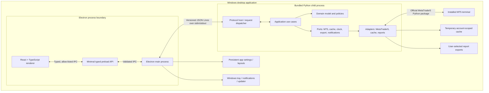

# 17 — MT5 Assistant: target architecture

> **Status:** Architecture baseline proposed from the repository's approved product specifications. This document describes the intended design, not implemented or verified software. Requirements remain authoritative where this document is silent. Recommendations and unresolved decisions are explicitly identified.

## 1. Purpose and architectural drivers

MT5 Assistant is a local-first Windows desktop application for monitoring and analysing one connected MetaTrader 5 account at a time, with a tightly bounded set of safeguarded position and pending-order management operations.

The architecture must preserve these invariants:

1. The app does not open new market or pending orders.
2. Only one account is active; account switching is an explicit disconnect/reconnect boundary.
3. The installed MT5 desktop terminal and official MetaTrader5 Python package are the integration path.
4. Live account/position/order snapshots refresh every five seconds; history synchronises initially and incrementally, never by full redownload every poll.
5. Trading records and derived analytics are temporary, account-scoped cache only—not a permanent trading-history database.
6. Persistent data is limited to application settings, layouts, custom EA metadata, diagnostic logs, user exports and user-created settings backups.
7. The MT5 trading password is never persisted or logged.
8. Python is authoritative for MT5 access, domain normalisation, synchronisation, analytics, risk evaluation and report generation.
9. The renderer has no direct Node.js, filesystem, MT5 or arbitrary IPC access.
10. A timed-out or interrupted management operation has an unknown outcome until reconciled with MT5; it is never blindly resent.
11. Stale, incomplete, unavailable and inferred data is visibly identified. Missing values are never fabricated.
12. Monitoring continues in the system tray; explicit exit stops monitoring.

## 2. Recommended architecture style

**Recommendation:** a modular monolith across two local processes, with ports-and-adapters boundaries inside the Python service and a presentation-focused Electron renderer.

This fits a single-user desktop product with no cloud deployment, one account at a time and a small number of tightly related domains. It gives independent UI and MT5 integration runtimes without imposing network services, distributed transactions, service discovery or operational overhead.

The process split is a security and runtime boundary, not a microservices architecture. Keep domain logic in cohesive Python packages and use explicit interfaces between packages. Introduce a separate process or service only when a measured reliability, performance, isolation or packaging requirement justifies it.

### Logical topology



### Runtime ownership

| Concern | Authoritative owner | Notes |
|---|---|---|
| Window, tray, single-instance, app lifecycle | Electron main | No business calculations |
| Renderer presentation and interaction | React/TypeScript | Presentation state only |
| Renderer-to-main boundary | Preload + main IPC | Narrow, typed, validated capabilities |
| Python process lifecycle | Electron main | Spawn, handshake, supervise, graceful stop |
| MT5 terminal/session access | Python MT5 adapter | No MT5 calls from Electron |
| Domain rules and use cases | Python application/domain | Independent of UI and vendor API |
| History/cache lifecycle | Python synchronisation/cache | Account-scoped, temporary retention |
| Financial calculations | Shared Python analytics | One calculation implementation for all views |
| Risk checks and trade requests | Python trade/risk services | Revalidate immediately before request |
| PDF/XLSX/CSV creation | Python reporting | Long-running cancellable jobs |
| Durable app preferences | Electron main-owned storage adapter | DPAPI where appropriate |
| Custom EA metadata | Local persistence adapter | No trading history |
| Optional MQL5 heartbeat | Python local integration adapter | Evidence only; no trading |

## 3. Deployment topology and technology

| Layer | Target technology | Architectural constraint |
|---|---|---|
| Desktop shell | Electron, TypeScript | Main process owns OS capabilities |
| UI | React, TypeScript, HTML, CSS | No Node integration; accessible, responsive desktop UI |
| Bridge | Electron preload, typed IPC | Explicit allow-list; no generic IPC exposure |
| Local service | Bundled 64-bit Python runtime | Child process, no network listener |
| MT5 adapter | Official MetaTrader5 Python package | Requires compatible installed MT5 terminal |
| Process protocol | Versioned JSON Lines | stdin/stdout; stdout protocol only |
| Cache | Temporary local cache, format TBD | Configurable retention; clearable; account-scoped |
| Durable settings | Local app-data storage | DPAPI protection where appropriate |
| Reporting | Python PDF/XLSX/CSV exporters | User-selected destination; on demand |
| Optional EA companion | MQL5 | Guided optional install; heartbeat only |
| Distribution | Signed x64 Windows MSI | Windows 10/11; terminal remains separate |
| CI/source | GitHub workflows | Automated tests and stable tagged releases |

Use TypeScript for UI, desktop contracts, IPC clients, view models and renderer validation. Use Python for MT5 integration, domain workflows, synchronisation, financial calculations, risk, alert evaluation and reports. HTML/CSS remain presentation technologies. MQL5 is optional and narrowly scoped to a local EA heartbeat. Do not introduce C++, Rust or another lower-level language without a demonstrated native capability or performance requirement that cannot be met safely by the selected stack.

## 4. Layered design and dependency rules

### 4.1 Renderer / presentation

Pages: Dashboard; Positions & Pending Orders; Trading History; Expert Advisors; Account Analytics; Reports; Notifications; Settings.

The renderer:
- Requests data through named preload methods only.
- Displays server-provided domain values and data-quality metadata.
- Maintains ephemeral view state, filters, sorting, chart selection and widget layout state.
- Does not calculate financial metrics or decide whether a trade request is safe.
- Does not hold credentials longer than the authentication interaction requires.
- Never accepts executable code, arbitrary paths or unrestricted file operations from user-controlled content.

### 4.2 Electron main / desktop application

Responsibilities:
- Single-instance enforcement and app lifecycle.
- Secure BrowserWindow creation and hardening.
- Strict IPC routing, validation, authorization state and rate/size limits.
- Python process startup, handshake, supervision, restart policy and graceful shutdown.
- App-password gate and inactivity/minimise lock lifecycle.
- Durable settings/layout storage and DPAPI adapter.
- System tray, Windows notifications, native dialogs and update orchestration.
- Controlled export-folder selection; pass only validated user-approved destinations to the service.

Main should not contain PnL formulas, MT5 vendor calls, trading domain rules or report composition logic.

### 4.3 Python protocol host and application layer

The protocol host validates envelopes, negotiates protocol capabilities, dispatches requests to application use cases and serialises typed responses/events. It owns no domain policy beyond transport validation.

Application use cases coordinate domain services and ports. Suggested use cases:
- DiscoverTerminal, ConnectAccount, DisconnectAccount, SwitchAccount.
- GetDashboardSnapshot, RefreshLiveSnapshot.
- StartInitialHistorySync, SyncHistoryIncrementally, ReconcileAccount.
- QueryPositions, QueryOrders, QueryHistory, QueryAnalytics.
- ListEAInstances, UpdateEAMetadata, GetEAStatus.
- EvaluateRisk, ExecuteManagementOperation, ReconcileOperation.
- EvaluateAlerts, AcknowledgeAlert, ListNotifications.
- GenerateReport, CancelReportJob.
- ReceiveEAHeartbeat (optional capability).

### 4.4 Domain layer

Contains normalised account, symbol, position, order, deal, cash movement, EA identity, alert, risk policy and management-operation concepts; calculation definitions; invariants; state transitions; domain errors; and ports.

Domain code must not import Electron, React, the MetaTrader5 package, filesystem APIs or report-library implementation details.

### 4.5 Adapters / infrastructure

Adapters implement the ports for MT5, temporary cache, settings/metadata storage, system clock/timezone, report writers, logging and optional MQL5 heartbeat transport. Vendor objects are converted to normalised domain DTOs at the adapter boundary. Vendor exceptions are mapped to stable application error codes.

## 5. Python package layout

Recommended package structure (names are a proposal, not a claim about current source files):

```text
python/
  mt5_assistant/
    protocol/          # envelopes, schemas, version negotiation, dispatcher
    application/       # use cases, orchestration, job management
    domain/
      accounts/        # account identity, snapshot, modes
      trading/         # positions, orders, deals, reconstruction
      instruments/     # symbols, broker constraints, sessions
      analytics/       # metric definitions and calculation interfaces
      ea/              # identity, attribution, instance status
      risk/            # risk policies, evaluation, action gating
      alerts/          # alert state machine and cooldown policy
    ports/             # interfaces for MT5, cache, clock, export, heartbeat
    adapters/
      mt5/             # terminal discovery, auth, market/account/trade API
      cache/           # temporary cache and retention
      persistence/     # settings/EA metadata adapters as applicable
      reports/         # PDF, XLSX, CSV writers
      heartbeat/       # optional local MQL5 input
    services/
      sync/            # snapshots, history, dedupe, reconciliation
      analytics/       # shared calculation engine
      reporting/       # report orchestration and progress
      monitoring/      # refresh scheduler, health, alert evaluation
    observability/     # redaction, structured logs, diagnostics
    bootstrap.py
  tests/
    unit/
    integration/
    fixtures/
```

Keep packages cohesive; avoid a generic `utils` dumping ground. Application services orchestrate; domain services calculate and enforce rules; adapters perform I/O.

## 6. TypeScript / Electron package layout

```text
desktop/
  src/
    main/
      lifecycle/
      windows/
      tray/
      ipc/             # schemas, handlers, authorization
      python/          # process manager and protocol client
      security/        # app-password, DPAPI adapter, lock state
      storage/         # settings and layout persistence
      notifications/
      updates/
    preload/           # narrow contextBridge API
    renderer/
      app/
      routes/
      features/
        dashboard/
        positions/
        history/
        eas/
        analytics/
        reports/
        notifications/
        settings/
      components/
      charts/
      state/           # presentation state only
      services/        # typed preload client
      i18n/
    shared/
      contracts/       # generated/shared IPC DTOs and enums
      validation/      # runtime schemas
      formatting/
  tests/
    unit/
    integration/
    e2e/
```

Use a monorepo with pinned toolchains and reproducible lockfiles. Keep shared contracts language-neutral at the process boundary; TypeScript and Python may each have generated or hand-maintained representations validated against the same protocol fixtures/schema.

## 7. Core domain model and ownership

| Entity | Key / identity | Notes |
|---|---|---|
| Account | broker/server + login identity + session generation | Exactly one active account context |
| AccountSnapshot | account + capture timestamp | Balance, equity, margin, currency, leverage |
| SymbolInfo | exact broker-native symbol | Prefixes/suffixes preserved; metadata is time-sensitive |
| Position | broker position identifier + account context | Never key by symbol alone |
| Order | broker order identifier + account context | Pending order lifecycle |
| Deal | broker deal identifier + account context | Immutable broker fact as observed |
| CashMovement | broker record identifier where available | Separate from trading profit |
| EAIdentity / EAInstance | stable local identity/instance key | Attribution method and confidence retained |
| DataQuality | resource category + observation | Current/stale/incomplete/unavailable |
| ManagementOperation | local operation UUID | Request, confirmation, submission and reconciliation states |
| Alert | alert type + scope + active episode | NORMAL/TRIGGERED/RECOVERED |
| ReportJob | local job ID | Progress, cancellation, terminal result |

Never assume order, deal and position identifiers are interchangeable. For hedging accounts, multiple positions can exist for one symbol; for netting accounts, a symbol position can aggregate deals and change direction/volume.

## 8. Principal workflows

### 8.1 Startup and connection

1. Electron main enforces single instance, loads minimal settings and enters the app-password gate.
2. After successful unlock, main starts the bundled Python service with a controlled environment and no secrets in command-line arguments.
3. Main waits for a protocol handshake containing protocol version, service version and capabilities; incompatible versions fail closed with an actionable diagnostic.
4. Main loads remembered terminal selection; Python discovers candidates or validates the selected executable.
5. Prefer an existing authenticated terminal session; manual credentials are transient and never written to settings, logs or process arguments.
6. Python validates account identity and data retrieval. Only then does the app mark the account connected and publish a fresh snapshot.
7. Start live refresh and background initial history sync. Dashboard progressively shows available data with quality markers.

### 8.2 Live monitoring and history

- A single coordinator schedules the five-second account/position/order refresh and avoids overlapping refreshes.
- Each category carries last-success time, freshness and error reason independently.
- Initial history sync is a cancellable background job.
- Incremental sync tracks the last successful server timestamp and stable identifiers, re-fetches a bounded overlap window, deduplicates/upserts idempotently and recomputes affected lifecycles.
- Periodic reconciliation compares recent history and account totals against MT5.
- Stale state is surfaced immediately after the configured grace policy is exceeded; recovery requires a successful fetch, not merely a running process.

### 8.3 Account switching

1. Require explicit disconnect/switch intent.
2. Stop account-scoped refresh and history jobs.
3. Invalidate in-memory snapshots, pending queries and temporary cache namespace for the old account according to retention policy.
4. Increment session generation so late responses from the old account are rejected.
5. Connect and validate the new account.
6. Do not render new-account data until identity is confirmed.

### 8.4 Trade management

1. UI asks for a typed action and target broker ID.
2. Main validates app state and forwards a typed request with a unique local operation ID.
3. Python resolves current target state and broker metadata; applies app risk policies and action allow-list; validates market session, volume, price precision, stops/freeze levels, filling/action support and account restrictions.
4. UI presents a confirmation summary based on current server-returned data; confirmation is explicit and bound to the operation intent.
5. Python re-reads/revalidates immediately before submitting to MT5.
6. The result is accepted/rejected/partial/unknown. Submission alone is never success.
7. Python reconciles actual positions/orders/deals. Unknown outcomes are never automatically retried.
8. Return per-item results, especially for close-all. Close-all applies to open positions only and never cancels pending orders.

### 8.5 Reporting

1. UI requests a report with date range, sections, charts, EA/instrument filters and detail options.
2. Python validates request and data coverage, snapshots the calculation inputs, and starts a cancellable job.
3. Shared analytics produces the canonical metrics and a report model.
4. Export adapter writes PDF/XLSX/CSV to the user-approved directory using safe filenames and atomic replacement where practical.
5. Never overwrite without confirmation; report includes currency, broker/server time basis, method and data limitations.

## 9. Analytics architecture

A single Python analytics engine is the source of truth for dashboard, account, instrument, EA and report metrics. UI may format or visualise results but may not independently recompute PnL, return, drawdown or win-rate.

Separate:
- Gross trading profit/loss.
- Commission, swap/financing and other fees.
- Net trading PnL.
- Floating PnL.
- Deposits, withdrawals and other non-trading cash movements.
- Cash-flow-adjusted percentage return.

Use broker-provided profit/cost semantics carefully to avoid double counting between deal and position aggregates. Use time-weighted return when valuations and cash-flow timestamps support it; otherwise a documented Modified Dietz approximation may be used and labelled. Drawdown from peak equity requires a sufficiently complete equity series; deal-only estimates must not be called account-equity drawdown. Capital allocation (balance/equity/margin) is distinct from market exposure by instrument/direction.

## 10. EA attribution and optional MQL5

Trade comment is the primary attribution signal; Magic Number is a fallback only when validated. Preserve raw comment/magic, attribution method and confidence (confirmed/inferred/unknown). Each instance is separately inspectable; grouping must not erase instance history.

Runtime state is evidence-based. Recommended states are RUNNING, IDLE, INACTIVE and UNKNOWN. Account history/open positions alone cannot prove attachment or active execution. An optional guided MQL5 companion may report a local heartbeat, instance ID, chart/symbol, EA identity and Algo Trading permission. It must not place/modify trades or alter strategy behaviour. If absent, runtime status remains unknown/inferred.

## 11. Resilience and concurrency

- One serialized MT5 command executor is recommended for operations whose ordering or package thread-safety is uncertain; validate concurrency behaviour against the supported package/terminal matrix.
- Poll jobs must not overlap; coalesce or skip a poll if the previous poll is still running and record the skipped interval.
- Long sync, analytics and report jobs run outside the UI/main event loop and expose progress/cancellation.
- Apply bounded timeouts and bounded retry with exponential backoff to idempotent reads only.
- Do not automatically retry non-idempotent trade requests after uncertain outcomes.
- Python restart is bounded; after restart, re-handshake, reconnect and reconcile account state before enabling management.
- On terminal loss, mark relevant data stale immediately and continue retrying with capped backoff.
- Graceful shutdown stops scheduling, cancels safe jobs, flushes permitted durable state and terminates the child process. Forced termination is last resort.

## 12. Architecture quality attributes

| Attribute | Design response | Verification |
|---|---|---|
| Safety | Backend-authoritative allow-list, broker revalidation, explicit confirmation, reconcile unknown outcomes | Negative trade tests, timeout/crash tests |
| Security | Sandboxed renderer, narrow preload, local process protocol, DPAPI, no persisted MT5 password | IPC abuse, secret scan, credential tests |
| Data integrity | Stable broker IDs, overlap sync, idempotent upsert, account namespace | Replay, duplicate, out-of-order fixtures |
| Accuracy | One Python calculation engine, explicit quality/method labels | Reconciliation fixtures against MT5 |
| Responsiveness | Progressive loading, async jobs, bounded payloads, no blocking main | UI responsiveness and latency tests |
| Availability | Backoff, bounded restart, stale indicators, graceful recovery | Disconnect/process-crash tests |
| Privacy | No cloud service or telemetry; explicit diagnostic sharing | Network/consent tests |
| Maintainability | Modular monolith, ports/adapters, typed protocol, ADRs | Dependency-boundary review |
| Portability within target | x64 Windows, pinned compatible runtime/package/terminal matrix | Clean Win10/11 install matrix |

## 13. Explicit non-goals

No cloud account, remote broker API, multi-account concurrent monitoring, permanent trading-history database, new trade entry, strategy execution, automated liquidation, scheduled report delivery, remote control, or telemetry by default. Do not add these through incidental implementation convenience.

## 14. Implementation sequence

1. **Foundation:** monorepo, pinned toolchains, CI, shared contracts, Python protocol host, Electron secure shell, test fixtures.
2. **Security and lifecycle:** app-password gate, DPAPI adapter, process supervision, logging/redaction, settings/layout persistence.
3. **MT5 connectivity:** discovery, session validation, account identity, symbol/account snapshots, disconnect/reconnect.
4. **Monitoring and data:** five-second refresh, initial/incremental history, cache retention, data quality, positions/orders/history.
5. **Analytics:** reconstruction, cash movement classification, PnL/returns/drawdown, portfolio/instrument views.
6. **EA and alerts:** attribution, metadata, evidence-based status, optional heartbeat, alert state/cooldown and tray delivery.
7. **Management and reports:** broker constraints, risk gate, operation state machine, reconciliation, report job/export.
8. **Release hardening:** real-terminal validation, clean Windows install, signing, updater, uninstall, docs and acceptance matrix.

Phases are internal milestones; they do not reduce the documented first-public-release scope.

## 15. Open design decisions

See [21 — Architecture decisions and validation register](21-architecture-decisions.md). In particular: exact Python/MetaTrader5 compatibility matrix, cache technology/retention, installer and updater technology, protocol schema/code generation, local heartbeat transport, risk defaults, backup encryption/migrations, reset boundaries and update distribution/signing.

## 16. Source-of-truth and change control

The product requirements and specialised specifications in documents 01 and 03–16 remain the requirement baseline. This architecture interprets and decomposes them; it does not silently approve open product decisions. When a requirement changes, update its source specification, this architecture, affected interface/decision documents, traceability and tests together.

Related documents:
- [Component boundaries and responsibilities](18-component-design.md)
- [Process protocol and interface contracts](19-protocol-and-data-contracts.md)
- [Security, data lifecycle and operations](20-security-data-operations.md)
- [Architecture decisions and validation register](21-architecture-decisions.md)
